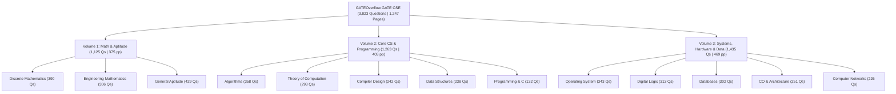

# GATEOverflow GATE CSE PDF Series Analysis (`filter1` Volumes 1–3)

## 1. Executive Summary

The workspace contains a complete 3-volume set of **GATEOverflow for GATE CSE** question-and-revision books generated in **May 2026** (`wkhtmltopdf 0.12.6.1`), covering **GATE Computer Science & Information Technology (1987–2026)** plus **General Aptitude**.

| File | File Size | Pages | Chapters | Questions | Primary Scope |
| :--- | :---: | :---: | :---: | :---: | :--- |
| [filter1_volume1.pdf](file:///Users/adityaasaha/Documents/Academics/Gate/filter1_volume1.pdf) | 13.85 MB | 375 | 11 | **1,125** | Discrete Mathematics, Engineering Mathematics & General Aptitude |
| [filter1_volume2.pdf](file:///Users/adityaasaha/Documents/Academics/Gate/filter1_volume2.pdf) | 14.91 MB | 403 | 6 | **1,263** | Algorithms, Compiler Design, Data Structures, Programming in C & TOC |
| [filter1_volume3.pdf](file:///Users/adityaasaha/Documents/Academics/Gate/filter1_volume3.pdf) | 17.02 MB | 469 | 5 | **1,435** | CO & Architecture, Computer Networks, Databases, Digital Logic & OS |
| **Total** | **45.78 MB** | **1,247** | **22** | **3,823** | **Full GATE CSE Syllabus (1987–2026)** |

> [!NOTE]
> **What "filter1" Represents & How Each Chapter is Structured**
> Unlike full discussion dumps that print multi-page community threads inline, these volumes are structured as **self-contained revision + practice workbooks**:
> 1. **Syllabus & Subject Overview**: Weightage expectations and how the subject connects to other GATE topics.
> 2. **Topic-wise Key Concepts**: Structured revision notes for every subtopic (*Definition & Core Idea*, *Important Formulas, Theorems & Results*, *Key Properties & Identities*, *Common Pitfalls / Tricky Points*, and *Standard Problem-Solving Techniques*).
> 3. **Quick Formula Reference & Important Tips for GATE**: High-yield cheat sheets before the problem sets.
> 4. **Topic-wise Past Questions (1987–2026)**: Questions grouped by subtopic with clickable `gateoverflow.in` links, metadata tags (`one-mark`, `two-marks`, `numerical-answers`, `multiple-selects`, `normal`, `easy`, `descriptive`), and an internal `Answer key☟` jump link.
> 5. **End-of-Chapter Answer Keys**: Compact answer key grid at the end of each chapter (avoiding spoilers while solving).

---

## 2. Syllabus Architecture Across Volumes

---

## 3. Volume-by-Volume Breakdown

### Volume 1: Discrete Math, Engineering Math & General Aptitude
* **File**: [filter1_volume1.pdf](file:///Users/adityaasaha/Documents/Academics/Gate/filter1_volume1.pdf) (375 pages, created `2026-05-24`)
* **Question Profile**: 435 `normal`, 172 `easy`, 14 `difficult`, 4 `tricky`, 69 `descriptive`, 142 `numerical-answers` (NAT), 57 `multiple-selects` (MSQ).

| Ch # | Subject / Chapter | Subtopics | Questions | Share of Vol 1 | Top High-Frequency Subtopics (Question Count) |
| :---: | :--- | :---: | :---: | :---: | :--- |
| **1** | **DM: Combinatory** | 8 | 51 | 4.5% | Combinatory (18), Recurrence Relation (7), Balls in Bins (6), Counting (6), Generating Functions (6) |
| **2** | **DM: Graph Theory** | 9 | 88 | 7.8% | Graph Connectivity (40), Degree of Graph (13), Graph Planarity (13), Graph Coloring (11) |
| **3** | **DM: Mathematical Logic** | 3 | 78 | 6.9% | Propositional Logic (40), First Order Logic (35), Logical Reasoning (3) |
| **4** | **DM: Set Theory & Algebra** | 13 | 173 | 15.4% | Relations (38), Group Theory (33), Functions (30), Set Theory (27), Lattice (10), Partial Order (10) |
| **5** | **Engg Math: Calculus** | 8 | 69 | 6.1% | Limits (15), Maxima Minima (14), Continuity (11), Differentiation (11), Integration (11) |
| **6** | **Engg Math: Linear Algebra** | 14 | 112 | 10.0% | Eigen Value (33), Matrix (24), System of Equations (17), Determinant (12), Rank (7), Vector Space (7) |
| **7** | **Engg Math: Probability** | 20 | 125 | 11.1% | Probability (31), Expectation (15), Conditional Probability (14), Uniform Dist. (11), Random Variable (10) |
| **8** | **GA: Analytical Aptitude** | 15 | 48 | 4.3% | Logical Reasoning (18), Statements Follow (7), Direction Sense (5), Sequence Series (3) |
| **9** | **GA: Quantitative Aptitude** | 59 | 197 | 17.5% | Probability (17), Numerical Computation (9), Ratio Proportion (9), Percentage (8), Functions (7), Tabular Data (7), Venn Diagram (7) |
| **10** | **GA: Spatial Aptitude** | 8 | 19 | 1.7% | Paper Folding (5), Patterns in 2D (4), Image Rotation (3), Patterns in 3D (3) |
| **11** | **GA: Verbal Aptitude** | 19 | 165 | 14.7% | Most Appropriate Word (47), Passage Reading (23), Verbal Reasoning (15), Word Pairs (14), Synonyms (13) |
| **—** | **Volume 1 Total** | **176** | **1,125** | **100%** | **Discrete Math: 390 \| Engg Math: 306 \| General Aptitude: 429** |

---

### Volume 2: Algorithms, Programming, Data Structures, TOC & Compilers
* **File**: [filter1_volume2.pdf](file:///Users/adityaasaha/Documents/Academics/Gate/filter1_volume2.pdf) (403 pages, created `2026-05-27`)
* **Question Profile**: 623 `normal`, 269 `easy`, 15 `difficult`, 149 `descriptive`, 148 `numerical-answers` (NAT), 86 `multiple-selects` (MSQ).

| Ch # | Subject / Chapter | Subtopics | Questions | Share of Vol 2 | Top High-Frequency Subtopics (Question Count) |
| :---: | :--- | :---: | :---: | :---: | :--- |
| **1** | **Algorithms** | 46 | 358 | 28.3% | Identify Function (38), Recurrence Relation (36), Minimum Spanning Tree (35), Time Complexity (31), Graph Search (23), Asymptotic Notations (22), Sorting (22), Quick Sort (15) |
| **2** | **Compiler Design** | 29 | 242 | 19.2% | Grammar (47), Parsing (22), Runtime Environment (22), LR Parser (20), Syntax Directed Translation (19), Parameter Passing (14), Compilation Phases (13), Intermediate Code (11) |
| **3** | **Programming & DS: Data Structures** | 17 | 238 | 18.8% | Binary Tree (53), Binary Search Tree (36), Binary Heap (30), Linked List (24), Stack (19), Hashing (15), Queue (15), Array (13), Tree (13) |
| **4** | **Programming & DS: Programming** | 1 | 1 | 0.1% | Output (1) *(plus C/C++/Python reference tables & operator precedence cheat sheets)* |
| **5** | **Programming: Programming in C** | 20 | 131 | 10.4% | Programming in C (29), Recursion (19), Pointers (15), Array (13), Parameter Passing (12), Loop Invariants (8), Output (8) |
| **6** | **Theory of Computation** | 21 | 293 | 23.2% | Finite Automata (43), Context Free Language (35), Regular Language (35), Identify Class Language (31), Decidability (30), Regular Expression (29), Minimal State Automata (25), Recursive & RE Languages (16), Pushdown Automata (15) |
| **—** | **Volume 2 Total** | **134** | **1,263** | **100%** | **Algo + DS + C: 728 \| TOC + Compiler Design: 535** |

---

### Volume 3: CO & Architecture, Networks, Databases, Digital Logic & OS
* **File**: [filter1_volume3.pdf](file:///Users/adityaasaha/Documents/Academics/Gate/filter1_volume3.pdf) (469 pages, created `2026-05-27`)
* **Question Profile**: 814 `normal`, 209 `easy`, 10 `difficult`, 149 `descriptive`, 219 `numerical-answers` (NAT), 98 `multiple-selects` (MSQ).

| Ch # | Subject / Chapter | Subtopics | Questions | Share of Vol 3 | Top High-Frequency Subtopics (Question Count) |
| :---: | :--- | :---: | :---: | :---: | :--- |
| **1** | **CO & Architecture** | 28 | 251 | 17.5% | Cache Memory (69), Pipelining (39), Machine Instruction (21), Addressing Modes (19), Microprogramming (12), Instruction Format (11), Interrupts (10) |
| **2** | **Computer Networks** | 38 | 226 | 15.7% | Subnetting (21), TCP (20), Sliding Window (16), Routing (14), Application Layer Protocols (13), IP Packet (12), Network Protocols (11), Congestion Control (9) |
| **3** | **Databases** | 27 | 302 | 21.0% | SQL (58), Database Normalization (56), Relational Algebra (33), B Tree (32), Transaction & Concurrency (27), Indexing (15), Relational Calculus (13), Conflict Serializable (12), ER Diagram (12) |
| **4** | **Digital Logic** | 36 | 313 | 21.8% | Number Representation (57), Circuit Output (40), Boolean Algebra (34), Digital Counter (18), K-Map (17), Min SOP Form (16), IEEE Representation (14), Multiplexer (14), Canonical Normal Form (10) |
| **5** | **Operating System** | 33 | 343 | 23.9% | Process Synchronization (52), Process Scheduling (49), Virtual Memory (43), Page Replacement (31), Disk (30), Resource Allocation (27), Disk Scheduling (16), Semaphore (11), Threads (10) |
| **—** | **Volume 3 Total** | **162** | **1,435** | **100%** | **OS + DBMS + CN: 871 \| Digital Logic + COA: 564** |

---

## 4. Key Insights & High-Yield Observations for GATE Preparation

1. **Up-to-Date Coverage Through GATE 2026**:
   - The question bank includes questions from **1987 right up to GATE 2025 and GATE 2026**, alongside classic **GATE IT (2004–2008)** papers.
   - Across all three volumes, **241 Multiple Select Questions (MSQs)** and **509 Numerical Answer Type (NAT)** questions are tagged, reflecting modern GATE patterns.
2. **Concentration of Marks (Pareto Distribution Across Subtopics)**:
   - Even though there are **472 subtopics** across the 22 chapters, just **25 core subtopics** account for over **35% of all technical questions**:
     - *CO & Architecture*: **Cache Memory** (69) + **Pipelining** (39) = **43%** of COA.
     - *Databases*: **SQL** (58) + **Normalization** (56) + **Relational Algebra** (33) + **B-Trees** (32) + **Transactions** (27) = **68%** of DBMS.
     - *Operating Systems*: **Process Synchronization** (52) + **Process Scheduling** (49) + **Virtual Memory & Page Replacement** (74) + **Disk/Scheduling** (46) = **64%** of OS.
     - *Theory of Computation*: **Finite Automata / Regular Languages / RE / Minimal DFA** (132) + **CFL / PDA** (52) + **Decidability** (30) = **73%** of TOC.
     - *Algorithms & DS*: **Binary Trees / BST / Heaps** (119 in DS) + **Time Complexity / Recurrences / Asymptotics** (89 in Algo) + **Graph Search & MST** (69 in Algo).
3. **Built-in Revision Notes Before Practice**:
   - Every chapter starts with a structured **Topic-wise Key Concepts** guide and a **Quick Formula Reference** before the questions begin—making each PDF usable both as a **formula/concept handbook** and a **question bank**.

---

## 5. Master Index of Chapter Study & Formula Documents (`chapters/`)

Each of the 22 chapters has a dedicated, research-expanded study document in `/Users/adityaasaha/Documents/Academics/Gate/chapters/` containing:
1. **Subtopic Weightage & Question Distribution**
2. **Expanded GATE CSE Reference (Reconstructed LaTeX Formulas, Theorems, Identities, Common Pitfalls & Shortcuts)**
3. **Original PDF Chapter Notes (Preserved Verbatim)**
4. **Complete Question Index & Matched Answer Keys**

### Volume 1 Chapters (Math & General Aptitude)
- [VOL1_CH01_DM_COMBINATORICS.md](file:///Users/adityaasaha/Documents/Academics/Gate/chapters/VOL1_CH01_DM_COMBINATORICS.md) — Discrete Mathematics: Combinatory (51 Qs)
- [VOL1_CH02_DM_GRAPH_THEORY.md](file:///Users/adityaasaha/Documents/Academics/Gate/chapters/VOL1_CH02_DM_GRAPH_THEORY.md) — Discrete Mathematics: Graph Theory (88 Qs)
- [VOL1_CH03_DM_MATHEMATICAL_LOGIC.md](file:///Users/adityaasaha/Documents/Academics/Gate/chapters/VOL1_CH03_DM_MATHEMATICAL_LOGIC.md) — Discrete Mathematics: Mathematical Logic (78 Qs)
- [VOL1_CH04_DM_SET_THEORY_ALGEBRA.md](file:///Users/adityaasaha/Documents/Academics/Gate/chapters/VOL1_CH04_DM_SET_THEORY_ALGEBRA.md) — Discrete Mathematics: Set Theory & Algebra (173 Qs)
- [VOL1_CH05_EM_CALCULUS.md](file:///Users/adityaasaha/Documents/Academics/Gate/chapters/VOL1_CH05_EM_CALCULUS.md) — Engineering Mathematics: Calculus (69 Qs)
- [VOL1_CH06_EM_LINEAR_ALGEBRA.md](file:///Users/adityaasaha/Documents/Academics/Gate/chapters/VOL1_CH06_EM_LINEAR_ALGEBRA.md) — Engineering Mathematics: Linear Algebra (112 Qs)
- [VOL1_CH07_EM_PROBABILITY.md](file:///Users/adityaasaha/Documents/Academics/Gate/chapters/VOL1_CH07_EM_PROBABILITY.md) — Engineering Mathematics: Probability (125 Qs)
- [VOL1_CH08_GA_ANALYTICAL_APTITUDE.md](file:///Users/adityaasaha/Documents/Academics/Gate/chapters/VOL1_CH08_GA_ANALYTICAL_APTITUDE.md) — General Aptitude: Analytical Aptitude (48 Qs)
- [VOL1_CH09_GA_QUANTITATIVE_APTITUDE.md](file:///Users/adityaasaha/Documents/Academics/Gate/chapters/VOL1_CH09_GA_QUANTITATIVE_APTITUDE.md) — General Aptitude: Quantitative Aptitude (197 Qs)
- [VOL1_CH10_GA_SPATIAL_APTITUDE.md](file:///Users/adityaasaha/Documents/Academics/Gate/chapters/VOL1_CH10_GA_SPATIAL_APTITUDE.md) — General Aptitude: Spatial Aptitude (19 Qs)
- [VOL1_CH11_GA_VERBAL_APTITUDE.md](file:///Users/adityaasaha/Documents/Academics/Gate/chapters/VOL1_CH11_GA_VERBAL_APTITUDE.md) — General Aptitude: Verbal Aptitude (165 Qs)

### Volume 2 Chapters (Algorithms, Programming, DS, TOC & Compiler Design)
- [VOL2_CH01_ALGORITHMS.md](file:///Users/adityaasaha/Documents/Academics/Gate/chapters/VOL2_CH01_ALGORITHMS.md) — Algorithms (358 Qs)
- [VOL2_CH02_COMPILER_DESIGN.md](file:///Users/adityaasaha/Documents/Academics/Gate/chapters/VOL2_CH02_COMPILER_DESIGN.md) — Compiler Design (242 Qs)
- [VOL2_CH03_DATA_STRUCTURES.md](file:///Users/adityaasaha/Documents/Academics/Gate/chapters/VOL2_CH03_DATA_STRUCTURES.md) — Programming and DS: Data Structures (238 Qs)
- [VOL2_CH04_PROGRAMMING_BASICS.md](file:///Users/adityaasaha/Documents/Academics/Gate/chapters/VOL2_CH04_PROGRAMMING_BASICS.md) — Programming and DS: Programming (1 Q)
- [VOL2_CH05_PROGRAMMING_IN_C.md](file:///Users/adityaasaha/Documents/Academics/Gate/chapters/VOL2_CH05_PROGRAMMING_IN_C.md) — Programming: Programming in C (131 Qs)
- [VOL2_CH06_THEORY_OF_COMPUTATION.md](file:///Users/adityaasaha/Documents/Academics/Gate/chapters/VOL2_CH06_THEORY_OF_COMPUTATION.md) — Theory of Computation (293 Qs)

### Volume 3 Chapters (COA, Networks, Databases, Digital Logic & OS)
- [VOL3_CH01_CO_AND_ARCHITECTURE.md](file:///Users/adityaasaha/Documents/Academics/Gate/chapters/VOL3_CH01_CO_AND_ARCHITECTURE.md) — CO & Architecture (251 Qs)
- [VOL3_CH02_COMPUTER_NETWORKS.md](file:///Users/adityaasaha/Documents/Academics/Gate/chapters/VOL3_CH02_COMPUTER_NETWORKS.md) — Computer Networks (226 Qs)
- [VOL3_CH03_DATABASES.md](file:///Users/adityaasaha/Documents/Academics/Gate/chapters/VOL3_CH03_DATABASES.md) — Databases (302 Qs)
- [VOL3_CH04_DIGITAL_LOGIC.md](file:///Users/adityaasaha/Documents/Academics/Gate/chapters/VOL3_CH04_DIGITAL_LOGIC.md) — Digital Logic (313 Qs)
- [VOL3_CH05_OPERATING_SYSTEM.md](file:///Users/adityaasaha/Documents/Academics/Gate/chapters/VOL3_CH05_OPERATING_SYSTEM.md) — Operating System (343 Qs)
